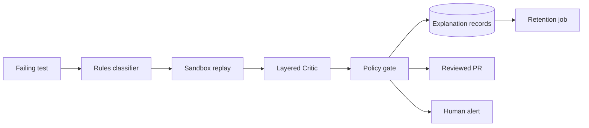

# Compliance support (tooling output; **legal review required**)

> This document and its generators produce *evidence*, not legal advice.
> A qualified human owner must review data handling, licenses, and vendor
> terms before any production use.

## Data-flow diagram (placeholder)

## Data classification

| Data | Class | Handling |
|---|---|---|
| Explanation records, audit log | Internal | Append-only, masked PII, retained per schedule |
| DOM snapshots, screenshots metadata | Confidential | PII-masked before storage or external calls |
| Credentials, private keys | Secret | Env vars only, never code/logs; rotated per policy |
| Benchmark fixtures | Public | Versioned in repo |

## Retention and deletion schedule

| Artifact | Retention | Enforced by |
|---|---|---|
| `records.jsonl`, `audit.log` | 365 days | `healing/security/retention.py` (dry-run default; `--apply` deletes) |
| `alerts.log` | 180 days | same job |
| `screenshots/` | 90 days | same job |

Run: `python -m scripts.retention` (dry-run) or `--apply` to delete.

## License scan and SBOM

- `python -m scripts.sbom` writes `sbom.json` (name, version, license per
  installed distribution, stdlib only).
- CI `compliance` job additionally runs `pip-licenses` when available and
  fails on unknown/copyleft licenses outside the allowlist
  (`MIT, Apache-2.0, BSD, ISC, PSF`).
- Healenium reuse: Apache-2.0, notices in `THIRD_PARTY_NOTICES.md` + `NOTICE`.

## Vendor and subprocessor register (template — owner must fill in)

| Vendor | Purpose | Data shared | DPA signed | Owner |
|---|---|---|---|---|
| *(e.g. CI provider)* | *(test execution)* | *(logs)* | *(yes/no)* | *(name)* |
| *(e.g. alerting/Slack)* | *(incident alerts)* | *(masked summaries)* | *(yes/no)* | *(name)* |
